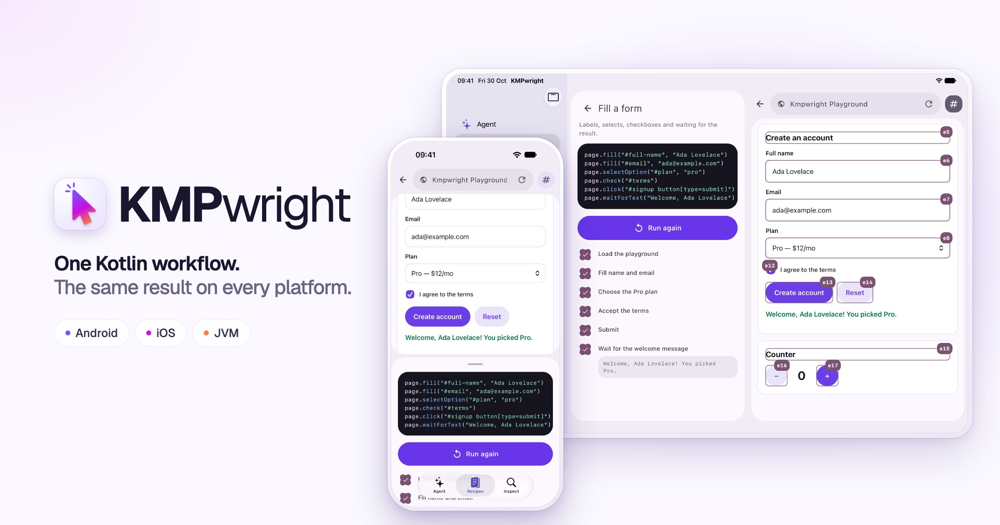
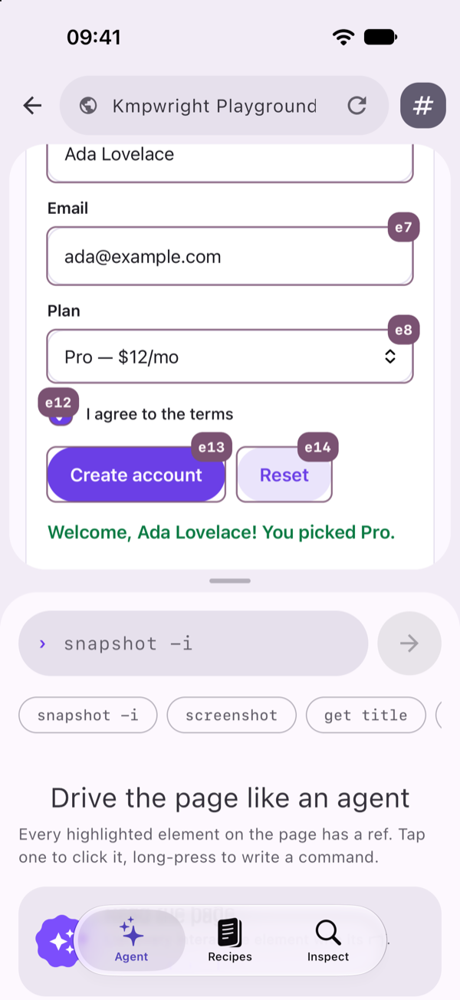

<h1 align="center">
  <a href="https://kmpwright.vercel.app"></a>
</h1>

<p align="center"><b>Browser automation for Kotlin Multiplatform.</b><br>
Write a workflow once and run it in Android WebView, iOS WKWebView or JVM Chromium.</p>

<p align="center">
  <a href="https://central.sonatype.com/artifact/io.github.bernaferrari/kmpwright-core"></a>
  
  <a href="LICENSE"></a>
</p>

<p align="center">
  <a href="https://kmpwright.vercel.app"><b>Website</b></a> ·
  <a href="https://kmpwright.vercel.app/docs"><b>Documentation</b></a> ·
  <a href="kmpwright-example-shared"><b>Examples</b></a>
</p>

A Playwright-inspired Kotlin API for locators, assertions, networking and
screenshots, plus compact commands an AI agent can drive the same browser with.

> [!NOTE]
> **0.0.2 alpha.** Available on Maven Central. APIs and platform coverage may change.

## Install

One dependency in `commonMain` covers Android, iOS and JVM. Gradle picks the platform variant.

```kotlin
kotlin {
    sourceSets {
        commonMain.dependencies {
            implementation("io.github.bernaferrari:kmpwright-core:0.0.2")
        }
    }
}
```

Requires `mavenCentral()`. For the Android Compose wrapper, add
`io.github.bernaferrari:kmpwright-compose:0.0.2` to `androidMain`.

## Write it once

Fill a form, click its button and check the result:

```kotlin
import com.bernaferrari.kmpwright.core.*

suspend fun demo(page: Page) = with(page) {
    setContent(demoHtml)
    getByLabel("Name").fill("Ada")
    getByRole("button", name = "Say hello").click()
    expect(getByRole("status")).toHaveText("Hello, Ada!")
}
```

The page shows **Hello, Ada!** and the assertion passes. Locators wait until an
element can be used; assertions wait for the expected result. No server or account needed.

<details>
<summary><code>demoHtml</code>, the self-contained page</summary>

```kotlin
val demoHtml = """
    <!doctype html>
    <html lang="en">
    <meta charset="utf-8">
    <title>KMPwright demo</title>
    <label for="name">Name</label>
    <input id="name">
    <button onclick="document.getElementById('greeting').textContent =
        'Hello, ' + document.getElementById('name').value + '!'">Say hello</button>
    <p id="greeting" role="status"></p>
    </html>
""".trimIndent()
```

</details>

## Run it anywhere

Connect your platform's browser and pass its `Page` to the shared workflow. Call
suspending APIs from a coroutine, on the main thread for mobile WebViews.

<table>
<tr>
<th>Android · WebView</th>
<th>iOS · WKWebView</th>
<th>JVM · Chromium</th>
</tr>
<tr>
<td>

```kotlin
Browser(
  AndroidPlatformContext(
    activity, webView,
  ),
).use { browser ->
  demo(browser.page())
}
```

</td>
<td>

```kotlin
Browser(
  IOSPlatformContext(
    webView = webView,
  ),
).use { browser ->
  demo(browser.page())
}
```

</td>
<td>

```kotlin
launchBrowser(
  executablePath,
).use { launched ->
  demo(
    launched.browser.newPage(),
  )
}
```

</td>
</tr>
<tr>
<td>Android 8+ · <a href="website/content/docs/platforms/android.mdx">guide</a></td>
<td>iOS 15+, arm64 device and simulator · <a href="website/content/docs/platforms/ios.mdx">guide</a></td>
<td>JDK 17+, installed Chrome or a cloud browser · <a href="website/content/docs/platforms/jvm.mdx">guide</a></td>
</tr>
</table>

Features follow each backend's abilities. Check `page.capabilities()` before an
optional feature; the [capability matrix](website/content/docs/platforms/capabilities.mdx)
lists what is partial or missing.

## Hand it to an agent



Expose `runCommand()` as a tool in your LLM SDK. The model reads a snapshot and
acts on element refs, using the [agent-browser command subset](website/content/docs/agents/commands.mdx).

```kotlin
page.runCommand("snapshot -i")
// @e1 [input type="email"]
// @e2 [button] "Sign in"

page.runCommand("fill @e1 ada@example.com")
page.runCommand("click @e2")
```

The [example app](kmpwright-example-shared) puts a playground, recipes and an
inspector on Android, iPhone and iPad.

<br clear="right">

## What else it does

- **Find and assert.** Roles, labels and text, with waiting built in. [Locators](website/content/docs/guides/locators.mdx)
- **Watch the network.** Intercept requests and read the history. [Networking](website/content/docs/guides/network.mdx)
- **Capture pages.** Screenshots and image comparison. [Screenshots](website/content/docs/guides/screenshots.mdx)
- **Keep a session.** Save and restore cookies and storage. [Session state](website/content/docs/guides/storage.mdx)
- **Record a run.** Video, traces and CPU profiles on Chromium. [Recording](website/content/docs/guides/recording.mdx)

## Credits

KMPwright adapts browser behavior from [agent-browser](https://github.com/vercel-labs/agent-browser)
into Kotlin APIs and is independent of Playwright. The
[upstream comparison](docs/compatibility/upstream-review.md) records the pinned
revision and coverage; no upstream source is included here.

Part of [Kotlin Reforge](https://kotlin-reforge.vercel.app).

<sub>Contributing? See [development and tests](docs/development.md) and the [release guide](docs/releasing.md). [MIT](LICENSE) · [Third-party notices](THIRD_PARTY_NOTICES.md)</sub>
