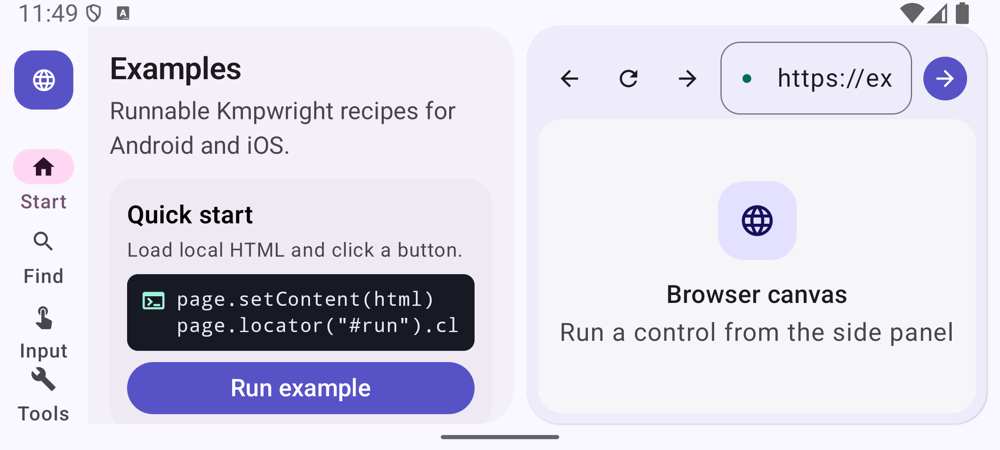
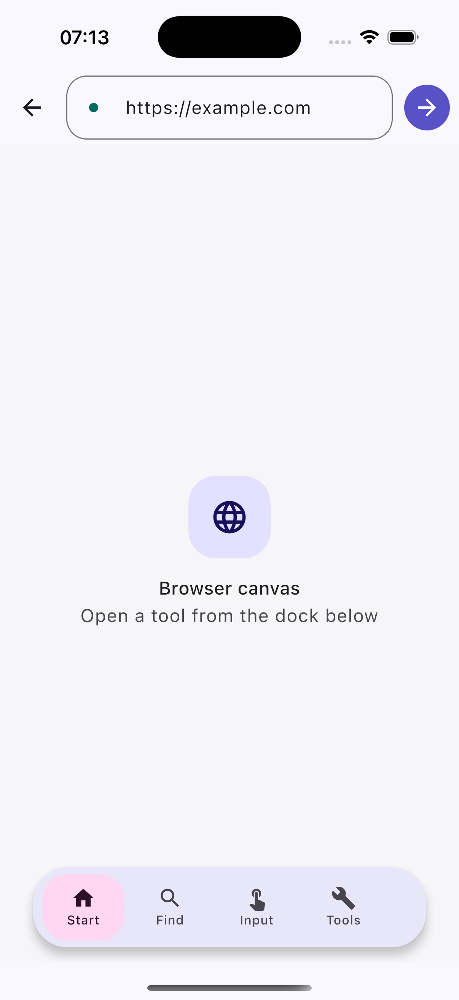

# KMPwright

<p align="center">
  
</p>

Write browser automation in shared Kotlin with a Playwright-inspired page and
locator API. Run it against your application's Android `WebView` or iOS
`WKWebView`, or launch and connect to Chromium on JVM.

```kotlin
import com.bernaferrari.kmpwright.core.*

suspend fun checkExample(page: Page): ScreenshotResult {
    page.goto("https://example.com")
    page.locator("h1").expect().toHaveText("Example Domain")
    return page.screenshot()
}
```

> [!IMPORTANT]
> **Alpha · 0.1.0.** Public Maven artifacts and release assets have not been
> published yet. Try the examples or build from source. APIs and platform
> coverage may change before the first release.

[Try the demo](#try-the-demo) · [Installation](#installation) ·
[Connect a browser](#connect-a-browser) · [Recipes](#recipes) ·
[Platform support](#platform-support) · [Build and test](#build-and-test)

## What you can do

- **Automate flows:** semantic locators, form input, navigation, assertions and waits.
- **Inspect pages:** accessibility snapshots and audits, Web Vitals, React components and WebMCP tools.
- **Capture results:** viewport, element and full-page screenshots; visual diffs; CDP video with cursors and contact sheets.
- **Work with data:** cookies, storage, saved sessions, HTTP Markdown reading, request history and HAR export.
- **Choose your browser:** embedded mobile WebViews, owned Chromium processes, existing CDP targets or cloud providers.
- **Set boundaries:** allowed origins, domain filters, action policies and encrypted session files.

Features follow each backend's capabilities. The [platform overview](#platform-support)
and [browser feature guide](docs/browser-features.md) explain where behavior differs.

## Try the demo

The shared Compose Multiplatform app puts automation controls beside a live
browser. Explore selectors, input, screenshots, cookies, session snapshots,
network capture and page inspection without writing a test harness.

<p align="center">
  
</p>

<details>
<summary>iOS phone layout</summary>

<p align="center">
  
</p>

</details>

Build requirements: JDK 17, the Android SDK for Android, and macOS with Xcode
for iOS. Run these commands from the repository root.

**Android** — install on a connected device or emulator:

```bash
./gradlew :example-android:installDebug
```

**iOS Simulator** — build the shared framework, then run the Xcode host:

```bash
./gradlew :kmpwright-example-shared:linkDebugFrameworkIosSim
open example-ios/KmpwrightExampleApp.xcodeproj
```

See the [iOS example setup](example-ios/README.md) for Xcode configuration.

## Installation

### From source today

Within this checkout, add the core module to your shared source set:

```kotlin
kotlin {
    sourceSets {
        commonMain.dependencies {
            implementation(project(":kmpwright-core"))
        }
    }
}
```

The optional Android Compose wrapper is `project(":kmpwright-compose")`.
For an external project, use the published dependencies once the release is available.

### Published dependencies

After `0.1.0` is published, add Maven Central to your dependency repositories
and use these coordinates:

```kotlin
repositories { mavenCentral() }

kotlin {
    sourceSets {
        commonMain.dependencies {
            implementation("io.github.bernaferrari:kmpwright-core:0.1.0")
        }
        androidMain.dependencies {
            // Optional Android Compose WebView wrapper.
            implementation("io.github.bernaferrari:kmpwright-compose:0.1.0")
        }
    }
}
```

The core provides Android, iOS and JVM targets. The Compose wrapper is Android-only.
Swift/Xcode consumers can use the static `KmpwrightCore.xcframework` release asset;
see the [release and integration guide](docs/releasing.md). Apple targets are
arm64 device and arm64 simulator, with iOS 15 as the minimum.

## Connect a browser

Navigation, actions, assertions and async cleanup are suspending APIs. Run the
examples below in a coroutine; create and operate mobile WebViews on the main thread.
The `checkExample(page)` function above works with each backend.

### Android WebView

Attach to a `WebView` your application displays:

```kotlin
val browser = Browser(AndroidPlatformContext(activity, webView))
try {
    checkExample(browser.page())
} finally {
    browser.closeAsync()
}
```

### iOS WKWebView

From `iosMain`, attach to your application's `WKWebView`:

```kotlin
val browser = Browser(IOSPlatformContext(webView = webView))
try {
    checkExample(browser.page())
} finally {
    browser.closeAsync()
}
```

Your app retains ownership of a supplied WebView. Closing the browser disposes
its automation resources. The [shared example](kmpwright-example-shared/src/commonMain)
shows how to connect page lifetimes to a Compose UI.

### Launch Chromium on JVM

Supply the path to an installed Chrome or Chromium executable. KMPwright launches
it headless by default and owns the process and temporary profile:

```kotlin
suspend fun checkInChromium(executablePath: String): ScreenshotResult {
    val launched = launchBrowser(BrowserLaunchOptions(executablePath))
    try {
        val page = launched.browser.newPageAsync()
        return checkExample(page)
    } finally {
        launched.closeAsync()
    }
}
```

Use `headless = false` for a visible browser. Launch options also support persistent
automation profiles, copies of existing Chrome profiles, extensions and a WebGPU
preset. See [launch and profile recipes](docs/browser-features.md#owned-chromium-launch-and-profiles).

### Connect to CDP or a cloud provider

Connect to an existing browser-scoped WebSocket endpoint:

```kotlin
val browser = Browser(
    JvmPlatformContext(),
    KmpwrightConfig(cdp = CdpConfig(
        websocketUrl = "ws://localhost:9222/devtools/browser/<id>"
    ))
)
try {
    checkExample(browser.newPageAsync())
} finally {
    browser.closeAsync()
}
```

Use `provider = CloudProvider.AutoConnect` to discover an already-running browser
with remote debugging enabled. To create a managed cloud session, select a provider and set its API key in the
process environment:

| Provider | Environment variable |
| --- | --- |
| `CloudProvider.Browserbase` | `BROWSERBASE_API_KEY` |
| `CloudProvider.Browserless` | `BROWSERLESS_API_KEY` |
| `CloudProvider.BrowserUse` | `BROWSER_USE_API_KEY` |
| `CloudProvider.Kernel` | `KERNEL_API_KEY` |

These providers use the same `CdpConfig(provider = …)` entry point.
Browserbase also accepts `BROWSERBASE_PROJECT_ID` when your account requires a project.

## Recipes

The snippets below assume an open `page` and the core imports shown above.

### Locators, input and assertions

```kotlin
page.locator("label=Email").fill("reader@example.com")
page.locator("label=Password").fill(passwordFromSecretStore)
page.locator("button[type=submit]").click()
page.locator(".notice").expect().toContainText("Welcome")

page.locator("#terms").check()
page.locator("select").selectOption("pro")
page.locator("input").press("Enter")
page.locator(".result").expect().toHaveCount(5)
```

Use semantic selectors for user-facing controls and CSS or XPath for structure:

| Selector | Example |
| --- | --- |
| Role | `role=button` |
| Label | `label=Email` |
| Text | `text=Continue` or `text:Continue` |
| Exact text | `exact_text=Submit order` |
| Placeholder | `placeholder=Search` |
| Image alternative text | `alt=Company logo` |
| Title | `title=Close` |
| Test ID | `testid=checkout` |
| CSS | `.results > article` |
| XPath | `xpath=//main//button` |

Chain locators or use `.nth(index)` with a zero-based index to narrow a result. Snapshot references can
also be addressed with `page.locatorByRef(refId)`.

### Wait for the result you need

```kotlin
page.goto("https://example.com", GotoOptions(waitUntil = LoadState.DOMContentLoaded))
page.locator("h1").waitFor()
```

For your application's state, wait for the relevant text or predicate:

```kotlin
page.waitForText("Saved")
page.waitForFunction("window.appReady === true")
```

Prefer element, text or predicate waits over fixed delays. `NetworkIdle` is
available, but persistent connections can prevent it and it does not establish
that an application has finished updating.

### Screenshots and accessibility

```kotlin
val viewport = page.screenshot()
val fullPage = page.screenshot(ScreenshotOptions(fullPage = true))
val chart = page.locator(".chart").screenshot()
val snapshot = page.accessibilitySnapshot(A11ySnapshotOptions(interactiveOnly = true))
val audit = page.accessibilityAudit(AccessibilityAuditOptions(tags = setOf("wcag2aa")))
```

CDP snapshots use Chromium's accessibility tree. Mobile snapshots use DOM
heuristics; audits report skipped child frames. Full-page capture also differs
by backend—check the [feature guide](docs/browser-features.md) for coverage.

### Read content and inspect requests

```kotlin
// Fetch content without navigating the browser or sharing its cookies.
val document = HttpReader().read("https://example.com")
println(document.content)

page.startHarCapture()
page.goto("https://example.com")
val archive = page.stopHarCapture()
val recentRequests = page.network.requests(limit = 10)
```

HAR capture works across backends: CDP includes available response bodies,
while mobile WebViews expose limited metadata. Redirects and cache eviction
can make CDP bodies unavailable.

### Record the current page on CDP

```kotlin
page.requireCapabilities(PageCapability.VideoRecording)
page.startRecording(RecordingOptions(
    path = "capture.mp4",
    fps = 30,
    contactSheetPath = "contact.png"
))
page.locator("button").click()
val recording = page.stopRecording()
```

Recording requires FFmpeg and supports MP4 or WebM at 1–60 FPS. It preserves the
current page's state and can include cursor feedback and a clean contact sheet.

For React inspection, WebMCP tools, routing, init scripts, login, encrypted state,
autosave and private certificate trust, see the [browser feature recipes](docs/browser-features.md).

## Platform support

| Target | Backend | Main differences |
| --- | --- | --- |
| Android 8+ | Android `WebView` | DOM input semantics, limited interception, shared WebView cookie storage; bounded scroll-and-stitch for full-page screenshots |
| iOS 15+ · arm64 | `WKWebView` | DOM input semantics; HTTP routing covers fetch/XHR bridge traffic and optional custom schemes |
| JVM · JDK 17+ | Chromium CDP | Trusted browser input, cross-process frames, browser targets/windows, video, tracing and V8 profiling |

Most APIs live in `commonMain`; their support level can be `Supported`, `Partial`
or `Unsupported`. Require the capabilities a workflow needs before it starts:

```kotlin
page.requireCapabilities(PageCapability.VideoRecording)

// Accept partial routing when it is sufficient for your workflow.
page.requireCapabilities(
    PageCapability.RouteInterception.require(minimum = SupportLevel.Partial)
)
```

For an optional feature, inspect
`page.capabilities().supportLevel(PageCapability.VideoRecording)` first.
Android cannot provide isolated in-process browser contexts. Experimental WebMCP
also depends on the selected Chromium build. See the [compatibility matrix](compatibility/agent-browser-compatibility.json)
for detailed mappings and the [validation record](compatibility/validation-checkpoint.json)
for tested coverage.

## Configure automation boundaries

```kotlin
val config = KmpwrightConfig(
    allowedOriginRules = setOf("https://app.example.com"),
    productionMode = true,
    allowEval = false,
    allowDomExtraction = false,
    enableTraceExport = false
)
```

Use `page.setDomainFilter(setOf("example.com", "*.static.example.com"))` for
request filtering, and `page.createContentBoundary()` / `page.boundedSnapshot()`
for marked content extraction. These are workflow controls; page content remains
untrusted, and filtering does not make a WebView a security sandbox.

Encrypted session-file saves require an explicit password. Keep credentials,
provider keys and session files out of source control. See the
[configuration API](kmpwright-core/src/commonMain/kotlin/com/bernaferrari/kmpwright/core/KmpwrightConfig.kt)
and [feature guide](docs/browser-features.md) for the available options.

## Build and test

```bash
# Build core/examples, run JVM tests and lint; also link iOS frameworks on macOS.
./scripts/ci-build.sh

# Android instrumentation: one activity, fresh WebViews, visible test/count progress.
./scripts/run-android-tests.sh DEVICE_SERIAL

# iOS backend contracts and shared example framework (macOS only).
./gradlew :kmpwright-core:iosSimTest :kmpwright-example-shared:linkReleaseFrameworkIosSim

# Documentation and upstream comparison metadata.
./scripts/verify-documentation.sh
./scripts/verify-agent-browser-compatibility.sh
```

Real Chromium tests require `KMPWRIGHT_TEST_CHROME` to point to the browser executable
and FFmpeg on `PATH`. To include the React fixture:

```bash
./scripts/build-react-fixture.sh
export KMPWRIGHT_TEST_CHROME="/path/to/chrome"
export KMPWRIGHT_TEST_REACT_BUNDLE="$PWD/.upstream/react-fixture/app.bundle.js"
./gradlew :kmpwright-core:jvmTest
```

[Dependency versions](docs/dependencies.md), [implementation notes](KMP_README.md)
and [release verification](docs/releasing.md) describe the tested toolchain and
artifact checks.

## Project layout

| Module | Purpose |
| --- | --- |
| `kmpwright-core` | Shared browser APIs and Android, iOS and JVM backends |
| `kmpwright-compose` | Android Compose WebView wrapper |
| `kmpwright-example-shared` | Shared Compose Multiplatform demo |
| `example-android` / `example-ios` | Platform hosts for the demo |
| `kmpwright-test` | Android instrumentation harness |
| `compatibility` | Upstream provenance, feature mappings and validation records |

## Upstream and contributing

KMPwright adapts browser behavior from [agent-browser](https://github.com/vercel-labs/agent-browser)
to Kotlin APIs and examples. The [upstream review](compatibility/upstream-review.md)
records the comparison commit, relevant changes and platform limits. The CLI,
daemon, MCP server, executable plugins and chat gateway are outside this library's
scope. Upstream source stays outside version control and is not required to build.

For contributions, keep portable behavior in `commonMain`, add meaningful contract
tests, and document backend differences through capabilities. Run the build and
documentation checks above before opening a change.

## License

[MIT](LICENSE) · Copyright 2026 Bernardo Ferrari.
See [third-party notices](THIRD_PARTY_NOTICES.md) for bundled code and dependencies.
