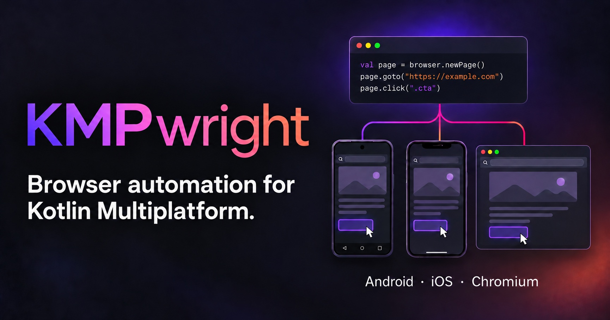

# KMPwright

<p align="center">
  
</p>

**Browser automation for Kotlin Multiplatform.** Write a workflow once and run it
inside Android WebView, iOS WKWebView or JVM Chromium. Use a Playwright-inspired
Kotlin API, or give an AI agent the same browser through compact commands.

[Documentation](docs/README.md) · [Agent guide](website/content/docs/agents/index.mdx) · [Examples](kmpwright-example-shared)

> [!NOTE]
> **0.0.1 alpha.** Available on Maven Central. APIs and platform coverage may change.

## Installation

Add to `commonMain.dependencies` in your module’s `build.gradle.kts`:

```kotlin
implementation("io.github.bernaferrari:kmpwright-core:0.0.1")
```

One dependency covers Android, iOS and JVM. Gradle selects the platform variant.
Requires `mavenCentral()` in your project's repositories.

<details>
<summary>Full Gradle setup and optional Compose integration</summary>

```kotlin
repositories { mavenCentral() }

kotlin {
    sourceSets {
        commonMain.dependencies {
            implementation("io.github.bernaferrari:kmpwright-core:0.0.1")
        }
    }
}
```

For the Android Compose wrapper, add this to `androidMain.dependencies`:

```kotlin
implementation("io.github.bernaferrari:kmpwright-compose:0.0.1")
```

</details>

## DSL in action

Fill a form, click its button and verify the rendered result. This demo uses a
self-contained page, so it runs without a server or an account.

```kotlin
import com.bernaferrari.kmpwright.core.*

suspend fun demo(page: Page) = with(page) {
    setContent(demoHtml)
    getByLabel("Name").fill("Ada")
    getByRole("button", name = "Say hello").click()
    expect(getByRole("status")).toHaveText("Hello, Ada!")
}
```

**Result:** the page displays **Hello, Ada!** and the assertion passes.
Locators wait for actionable elements; assertions wait for the expected result.
The same workflow runs on Android, iOS and JVM.

<details>
<summary>HTML for the runnable demo</summary>

Define this alongside `demo()` in your shared Kotlin code:

```kotlin
val demoHtml = """
    <!doctype html>
    <html lang="en">
    <meta charset="utf-8">
    <title>KMPwright demo</title>
    <label for="name">Name</label>
    <input id="name">
    <button onclick="document.getElementById('greeting').textContent =
        'Hello, ' + document.getElementById('name').value + '!'">Say hello</button>
    <p id="greeting" role="status"></p>
    </html>
""".trimIndent()
```

</details>

Connect your platform's browser, then pass its `Page` to the shared workflow.
Run suspending APIs in a coroutine, on the main thread for mobile WebViews.

<details>
<summary>Android, iOS and JVM examples</summary>

**Android** — attach to your app’s WebView:

```kotlin
Browser(AndroidPlatformContext(activity, webView)).use { browser ->
    demo(browser.page())
}
```

**iOS** — attach to your app’s WKWebView from `iosMain`:

```kotlin
Browser(IOSPlatformContext(webView = webView)).use { browser ->
    demo(browser.page())
}
```

**JVM** — launch an installed Chrome or Chromium:

```kotlin
launchBrowser(executablePath).use { launched ->
    demo(launched.browser.newPage())
}
```

See the platform guides for [Android](website/content/docs/platforms/android.mdx),
[iOS and Swift](website/content/docs/platforms/ios.mdx), and
[JVM and cloud browsers](website/content/docs/platforms/jvm.mdx).

</details>

## AI agents

```kotlin
page.runCommand("snapshot -i")
// @e1 [input type="email"]
// @e2 [button] "Sign in"

page.runCommand("fill @e1 ada@example.com")
page.runCommand("click @e2")
```

Expose `runCommand()` as a tool to your LLM SDK. The model reads snapshots and
acts on element references, using the documented
[agent-browser command subset](website/content/docs/agents/commands.mdx).

## Features

| Workflow | Guide |
| --- | --- |
| Find elements, enter text and assert results | [Locators](website/content/docs/guides/locators.mdx) |
| Intercept requests and inspect network history | [Networking](website/content/docs/guides/network.mdx) |
| Capture pages and compare images | [Screenshots](website/content/docs/guides/screenshots.mdx) |
| Save cookies and browser storage | [Session state](website/content/docs/guides/storage.mdx) |
| Record a Chromium workflow | [Recording](website/content/docs/guides/recording.mdx) |

## Platform support

| Platform | Browser | Minimum |
| --- | --- | --- |
| Android | WebView | Android 8 |
| iOS | WKWebView | iOS 15 · arm64 device and simulator |
| JVM | Chromium through CDP | JDK 17 |

Features follow each backend’s abilities. Inspect `page.capabilities()` before
using an optional feature; the [capability matrix](website/content/docs/platforms/capabilities.mdx)
explains partial and unsupported behavior.

## Contributing and attribution

KMPwright adapts browser behavior from [agent-browser](https://github.com/vercel-labs/agent-browser)
into Kotlin APIs. It is independent of Playwright. The
[upstream comparison](docs/compatibility/upstream-review.md) records the pinned
revision and coverage; upstream source is not included in this repository.

For contributions, see [development and tests](docs/development.md). For artifact
verification, see the [release guide](docs/releasing.md).

[MIT](LICENSE) · [Third-party notices](THIRD_PARTY_NOTICES.md)
